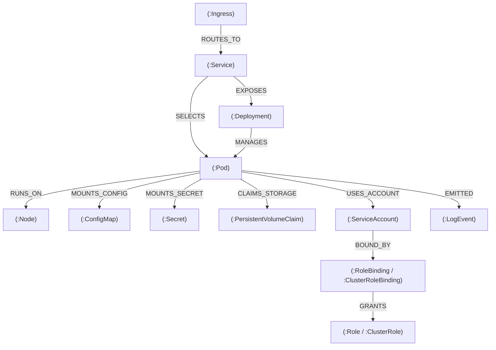
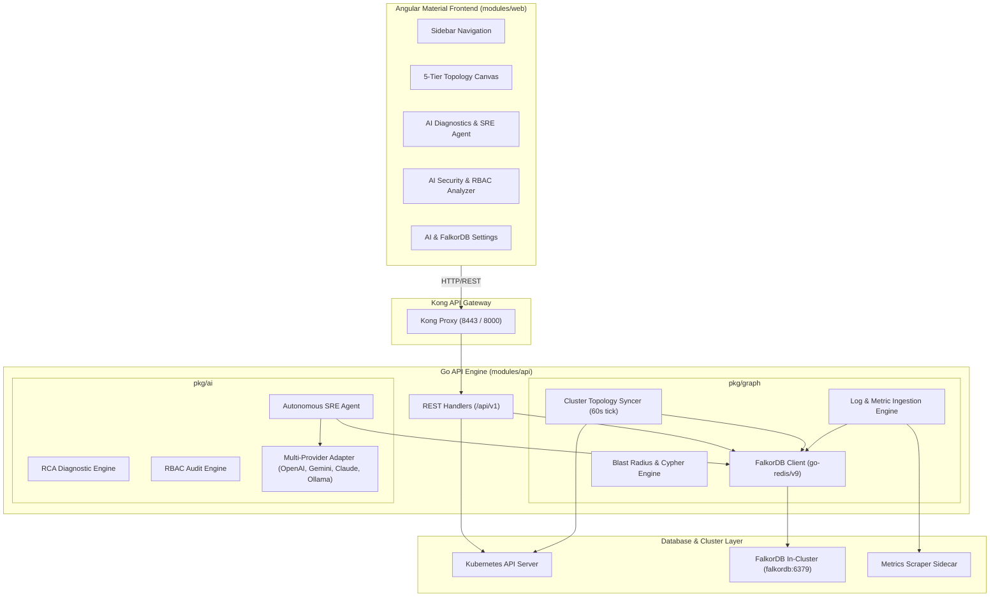

# Pilot Kubernetes

> **AI-Native Kubernetes Operations & Autonomous SRE Platform Powered by FalkorDB**  
> **Hackathon Track:** *Agents That Act on Connected Data* (Graph Hacks: Context for AI Agents)  
> **Team:** Pilot Kubernetes | **Team Code:** `S7XGAM`  
> **License:** Apache License 2.0

[](LICENSE)
[](https://www.falkordb.com/)
[](https://golang.org/)
[](https://angular.io/)
[](https://kubernetes.io/)

---

## Table of Contents

1. [Overview & Concept](#1-overview--concept)
2. [The Core Problem: Why Flat Dashboards and Naive LLMs Fail](#2-the-core-problem-why-flat-dashboards-and-naive-llms-fail)
3. [The FalkorDB Solution: Relational Infrastructure Intelligence](#3-the-falkordb-solution-relational-infrastructure-intelligence)
4. [What We Built on Top: Architecture & Features](#4-what-we-built-on-top-architecture--features)
   - [Autonomous AI SRE Problem-Solving Agent](#41-autonomous-ai-sre-problem-solving-agent)
   - [Interactive 5-Tier Topology Canvas](#42-interactive-5-tier-topology-canvas)
   - [AI Security Analyzer & RBAC Attack Paths](#43-ai-security-analyzer--rbac-attack-paths)
   - [Telemetry Graph: Real-Time Metrics & Log Events](#44-telemetry-graph-real-time-metrics--log-events)
   - [Cypher Query Catalog & Graph-Backed Dashboards](#45-cypher-query-catalog--graph-backed-dashboards)
5. [Graph Data Model & Schema](#5-graph-data-model--schema)
6. [Core Cypher Queries & Graph Algorithms](#6-core-cypher-queries--graph-algorithms)
   - [1. Multi-Hop Blast Radius Calculation](#61-multi-hop-blast-radius-calculation)
   - [2. Transitive RBAC Privilege Escalation Chain Discovery](#62-transitive-rbac-privilege-escalation-chain-discovery)
   - [3. Multi-Entity Service to Log Event Correlation](#63-multi-entity-service-to-log-event-correlation)
   - [4. Neighborhood Exploration](#64-neighborhood-exploration)
7. [System Architecture](#7-system-architecture)
8. [Installation & Deployment](#8-installation--deployment)
   - [Method 1: Production Helm Chart (Recommended)](#81-method-1-production-helm-chart-recommended)
   - [Method 2: Local Development & Image Build](#82-method-2-local-development--image-build)
   - [Method 3: Accessing Dashboard & Port-Forwarding](#83-method-3-accessing-dashboard--port-forwarding)
9. [Configuring AI Providers & FalkorDB](#9-configuring-ai-providers--falkordb)
10. [Verification & Health Checks](#10-verification--health-checks)
11. [Demo Video & Submission Details](#11-demo-video--submission-details)
12. [License](#12-license)

---

## 1. Overview & Concept

**Pilot Kubernetes** transforms the Kubernetes Dashboard from a passive, siloed resource viewer into an active, **AI-native autonomous operations platform**.

Instead of treating Kubernetes as flat lists of disconnected tables, Pilot Kubernetes deploys an in-cluster **FalkorDB** graph engine. Continuous background synchronization processes (`pkg/graph/syncer.go` and `pkg/graph/telemetry.go`) model the cluster as a living, multi-layered property graph. 

When operational incidents, latency spikes, or security misconfigurations arise, an **Autonomous AI SRE Agent** uses graph algorithms and multi-hop Cypher queries as its primary tools. The agent reasons across workloads, network routes, telemetry events, and RBAC policies to produce verifiable, grounded root causes and executable 1-click remediations.

---

## 2. The Core Problem: Why Flat Dashboards and Naive LLMs Fail

### The Limitations of Standard Kubernetes Dashboards
1. **Disconnected Silos:** Traditional Kubernetes UIs present resources in isolated pages (Pods, Services, Ingresses, RBAC). When an incident occurs, an operator must mentally construct the dependency tree across dozens of browser tabs.
2. **Missing Causal Chains:** A crashing pod is often a symptom, not the root cause. If an upstream service port was misconfigured or a ConfigMap was updated with an invalid URI, standard tools show the crashing pod in isolation.

### Why Standard LLM Integrations Hallucinate
1. **Context Window Exhaustion:** Dumping raw YAML dumps, cluster metrics, and mega-lines of logs into an LLM context window is cost-prohibitive, introduces high latency, and triggers token exhaustion.
2. **Topological Blindness:** Standard LLMs lack spatial and structural awareness. When presented with a pod failure, a generic model blindly suggests *"restart the pod"* or *"increase replica count"*, completely unaware that restarting will cause cascading timeouts across dependent upstream microservices.

---

## 3. The FalkorDB Solution: Relational Infrastructure Intelligence

FalkorDB provides the critical missing layer: **connected, high-speed in-memory graph intelligence**.

```
Live Cluster State (K8s API)  ──┐
                                ├──►  FalkorDB Graph (6379/TCP)  ◄──►  Autonomous AI SRE Agent
Live Telemetry (Logs & Metrics) ──┘        (Redis/Cypher Engine)           (Multi-Hop Graph Tools)
```

### Why FalkorDB is Integral (Hackathon Rule 3 Compliance)
FalkorDB is not a visualization cache; it is the **computational core** of Pilot Kubernetes:
* **Blast Radius Calculation:** Uses Cypher variable-length path traversal (`<-[*1..4]-`) to identify everything that depends on a resource before an engineer or agent touches it.
* **Graph RAG (Retrieval-Augmented Generation):** Rather than sending raw dumps, the AI retrieves subgraphs centered on affected resources (`falkordb_explore` and `falkordb_blast_radius`).
* **Multi-Entity Telemetry Correlation:** Queries paths connecting Services to Pods to LogEvent nodes (`(:Service)-[:SELECTS]->(:Pod)-[:EMITTED]->(:LogEvent)`).
* **Transitive Security Pathfinding:** Traces complex RBAC privilege escalation chains spanning ServiceAccounts, RoleBindings, and Roles.

*If FalkorDB is removed, the blast radius engine, RBAC attack path detector, AI SRE agent grounding, and topology correlation immediately stop functioning.*

---

## 4. What We Built on Top: Architecture & Features

### 4.1. Autonomous AI SRE Problem-Solving Agent
Implemented in [`modules/api/pkg/ai/agent.go`](modules/api/pkg/ai/agent.go):
- **Graph-First Tool Invocation:** The agent automatically calls FalkorDB tools:
  - `falkordb_blast_radius(resource, maxHops=4)`
  - `falkordb_explore(resource)`
  - `falkordb_diagnose_service(service)`
  - `falkordb_attack_paths(namespace)`
- **Traceable Actions:** Every recommendation includes the exact Cypher query executed, a summary of protected upstream workloads, safe `kubectl` inspection commands, and ready-to-apply YAML remediation patches.
- **Resource Mentions:** Supports auto-completed `@deployment/name`, `@pod/name`, or `@service/name` tags in natural language queries.

### 4.2. Interactive 5-Tier Topology Canvas
Implemented in [`modules/web/src/ai/traffic/`](modules/web/src/ai/traffic/):
- Replaced flat table views with an interactive SVG topology canvas organized into five clean architectural tiers:
  - **Tier 0:** Ingresses
  - **Tier 1:** Services
  - **Tier 2:** Workloads (Deployments, StatefulSets, DaemonSets, Jobs, CronJobs)
  - **Tier 3:** Pods
  - **Tier 4:** Config & Storage (ConfigMaps, Secrets, PVCs, ServiceAccounts)
- Features namespace scoping, workload isolation, cubic bezier connection paths, and an inspector slide-over linking directly to AI diagnostics.

### 4.3. AI Security Analyzer & RBAC Attack Paths
Implemented in [`modules/api/pkg/ai/security.go`](modules/api/pkg/ai/security.go) & [`modules/api/pkg/graph/result.go`](modules/api/pkg/graph/result.go):
- Audits Pod Security Standards (PSS) and privilege escalation risks.
- Executes Cypher graph pathfinding to uncover indirect permissions where unprivileged ServiceAccounts inherit sensitive access (`*`, `secrets`, `impersonate`, `escalate`) via nested bindings.
- Generates 1-click hardened, least-privilege Role manifests.

### 4.4. Telemetry Graph: Real-Time Metrics & Log Events
Implemented in [`modules/api/pkg/graph/telemetry.go`](modules/api/pkg/graph/telemetry.go):
- Ingests CPU usage rate (`cpuMilli`) and memory consumption (`memoryMi`) directly onto `Node` and `Pod` graph nodes.
- Tails pod log streams, classifies warning and error events, and constructs rolling `(:Pod)-[:EMITTED]->(:LogEvent)` relationships capped by retention to prevent graph bloat while preserving diagnostic history.

### 4.5. Cypher Query Catalog & Graph-Backed Dashboards
Implemented in [`modules/api/pkg/graph/query.go`](modules/api/pkg/graph/query.go):
- Built-in curated catalog of read-only operational Cypher queries.
- Allows operators to run natural-language questions translated to Cypher.
- Custom dashboards are saved as first-class `Dashboard` and `DashboardQuery` nodes inside FalkorDB.

---

## 5. Graph Data Model & Schema

The cluster graph in FalkorDB (graph name `kubepilot`) implements the following labeled property graph:



### Node Labels & Properties
| Node Label | Key Properties |
| :--- | :--- |
| `Namespace` | `name`, `status` |
| `Node` | `name`, `status`, `cpuCapacity`, `memoryCapacity`, `cpuMilli`, `memoryMi` |
| `Pod` | `name`, `namespace`, `nodeName`, `status`, `ip`, `cpuMilli`, `memoryMi` |
| `Deployment` | `name`, `namespace`, `replicas`, `readyReplicas`, `image` |
| `Service` | `name`, `namespace`, `type`, `clusterIP`, `ports` |
| `Ingress` | `name`, `namespace`, `hosts`, `rules` |
| `ServiceAccount` | `name`, `namespace` |
| `Role` / `ClusterRole` | `name`, `namespace`, `rules`, `sensitive` (boolean) |
| `RoleBinding` / `ClusterRoleBinding` | `name`, `namespace`, `roleRef` |
| `LogEvent` | `id`, `pod`, `namespace`, `container`, `level`, `timestamp`, `message` |

---

## 6. Core Cypher Queries & Graph Algorithms

Below are the primary Cypher queries driving the platform:

### 6.1. Multi-Hop Blast Radius Calculation
Calculates upstream dependencies (what the resource needs) and downstream dependents (what breaks if this resource fails):
```cypher
// Downstream Blast Radius: Transitive Dependents (1 to 4 hops)
MATCH (n:Service {name: $name, namespace: $namespace})<-[*1..4]-(d)
RETURN DISTINCT d.name, d.namespace, labels(d), d.status

// Upstream Dependencies: Prerequisites (1 to 4 hops)
MATCH (n:Service {name: $name, namespace: $namespace})-[*1..4]->(u)
RETURN DISTINCT u.name, u.namespace, labels(u), u.status
```

### 6.2. Transitive RBAC Privilege Escalation Chain Discovery
Identifies unprivileged ServiceAccounts granted sensitive cluster capabilities through multi-tier bindings:
```cypher
MATCH (sa:ServiceAccount {namespace: $namespace})-[:BOUND_BY]->(b)-[:GRANTS]->(r)
WHERE (r:Role OR r:ClusterRole) AND r.sensitive = 'true'
RETURN sa.name AS serviceAccount, 
       sa.namespace AS namespace, 
       b.name AS binding, 
       labels(b)[0] AS bindingKind, 
       r.name AS role, 
       labels(r)[0] AS roleKind
```

### 6.3. Multi-Entity Service to Log Event Correlation
Correlates a service with its underlying pods, health states, and error log events:
```cypher
MATCH (s:Service {name: $serviceName, namespace: $namespace})-[:SELECTS]->(p:Pod)
OPTIONAL MATCH (p)-[:EMITTED]->(l:LogEvent)
WHERE l.level IN ['ERROR', 'WARN']
RETURN s, p, l
ORDER BY l.timestamp DESC
LIMIT 50
```

### 6.4. Neighborhood Exploration
Retrieves immediate 1-hop topological context for Graph RAG agent reasoning:
```cypher
MATCH (n:Pod {name: $name, namespace: $namespace})-[*1]-(m)
RETURN DISTINCT m.name, m.namespace, labels(m), m.status
```

---

## 7. System Architecture



---

## 8. Installation & Deployment

Pilot Kubernetes is packaged as a complete, self-contained Helm chart that deploys the Web UI, API Backend, Kong Gateway, Metrics Scraper, and FalkorDB in a single operation.

### 8.1. Method 1: Production Helm Chart (Recommended)

From the root directory of this repository:

```bash
# 1. Create the namespace and deploy Pilot Kubernetes with embedded FalkorDB
helm upgrade --install pilot-dashboard ./charts/kubernetes-dashboard \
  --namespace kubernetes-dashboard \
  --create-namespace \
  --set falkordb.enabled=true \
  --set falkordb.persistence.enabled=true

# 2. Verify all pods are running (all should reach 1/1 Running)
kubectl get pods -n kubernetes-dashboard
```

Output:
```
NAME                                                   READY   STATUS    RESTARTS   AGE
falkordb-7dc8fbfd78-vnmht                             1/1     Running   0          2m
pilot-dashboard-kong-5c84d96b75-47s6p                 1/1     Running   0          2m
pilot-dashboard-kubernetes-dashboard-api-5cbc4586bf    1/1     Running   0          2m
pilot-dashboard-kubernetes-dashboard-auth-7d4dbf7745   1/1     Running   0          2m
pilot-dashboard-kubernetes-dashboard-metrics-scraper   1/1     Running   0          2m
pilot-dashboard-kubernetes-dashboard-web-7774c78c59    1/1     Running   0          2m
```

---

### 8.2. Method 2: Local Development & Image Build

If you are modifying Go or Angular code locally, build and update container images:

```bash
# In the pilot/ repository root:

# 1. Build the Go API backend container
docker build -t pilot-dashboard-api:latest -f modules/api/Dockerfile .

# 2. Build the Angular Web frontend container
docker build -t pilot-dashboard-web:latest -f modules/web/Dockerfile .

# 3. Reload deployments in the cluster
kubectl rollout restart deployment/pilot-dashboard-kubernetes-dashboard-api -n kubernetes-dashboard
kubectl rollout restart deployment/pilot-dashboard-kubernetes-dashboard-web -n kubernetes-dashboard
```

---

### 8.3. Method 3: Accessing Dashboard & Port-Forwarding

Choose one of two access methods:

#### Option A: Direct Web Frontend (HTTP, no certificate warnings)
```bash
kubectl port-forward -n kubernetes-dashboard svc/pilot-dashboard-kubernetes-dashboard-web 8080:8000
```
Open **`http://localhost:8080`** in your browser.

#### Option B: Via Kong Gateway (HTTPS)
```bash
kubectl port-forward -n kubernetes-dashboard svc/pilot-dashboard-kong-proxy 8443:443
```
Open **`https://localhost:8443`** in your browser *(accept the self-signed TLS certificate)*.

---

## 9. Configuring AI Providers & FalkorDB

1. In the Web UI, click the **Settings** gear icon in the top header.
2. Under **AI Provider Settings**, select your preferred provider:
   - **OpenAI:** Set API Key, choose `gpt-4o` or `o3-mini`.
   - **Google Gemini:** Set API Key, choose `gemini-1.5-pro` or `gemini-2.0-flash`.
   - **Anthropic Claude:** Set API Key, choose `claude-3-5-sonnet`.
   - **Local / Ollama / Custom:** Set Base URL (e.g. `http://host.docker.internal:11434/v1`) with zero API key required.
3. Under **FalkorDB Graph Settings**:
   - Host: `falkordb.kubernetes-dashboard.svc.cluster.local:6379` *(pre-configured)*
   - Graph Name: `kubepilot`
4. Click **Verify Connection** to check latency and confirm the green status indicator, then click **Save Configuration**.

---

## 10. Verification & Health Checks

Verify that FalkorDB and the API are synchronizing:

```bash
# 1. Test FalkorDB connectivity & statistics via API
curl -k http://localhost:8080/api/v1/graph/status
# Returns: {"connected":true,"graphName":"kubepilot","nodeCount":142,"edgeCount":318}

# 2. Fetch the typed cluster topology subgraph
curl -k http://localhost:8080/api/v1/graph/topology

# 3. Test multi-hop blast radius for a service
curl -k http://localhost:8080/api/v1/graph/blastradius/Service/kubernetes-dashboard/pilot-dashboard-kubernetes-dashboard-api

# 4. Check FalkorDB internal logs
kubectl logs -n kubernetes-dashboard deployment/falkordb --tail=20
```

---

## 11. Demo Video & Submission Details

- **Hackathon:** Graph Hacks: Context for AI Agents (WeMakeDevs & FalkorDB)
- **Track Entered:** **Agents That Act on Connected Data**
- **Repository:** [https://github.com/Niteesh57/Pilot-Kubernetes](https://github.com/Niteesh57/Pilot-Kubernetes)
- **Team Code:** `S7XGAM`
- **Team Members:**
  - Nagi Reddy BV (`@b_v_nagireddy`) - Leader
  - Manoj Ks (`@manoj8105`)
- **Demo Video:** *[Insert YouTube / Loom Link Here]*

---

## 12. License

This project is licensed under the **Apache License, Version 2.0**.

```
Copyright 2026 Pilot Kubernetes Authors
Copyright 2017 The Kubernetes Authors

Licensed under the Apache License, Version 2.0 (the "License");
you may not use this file except in compliance with the License.
You may obtain a copy of the License at

    http://www.apache.org/licenses/LICENSE-2.0

Unless required by applicable law or agreed to in writing, software
distributed under the License is distributed on an "AS IS" BASIS,
WITHOUT WARRANTIES OR CONDITIONS OF ANY KIND, either express or implied.
See the License for the specific language governing permissions and
limitations under the License.
```
